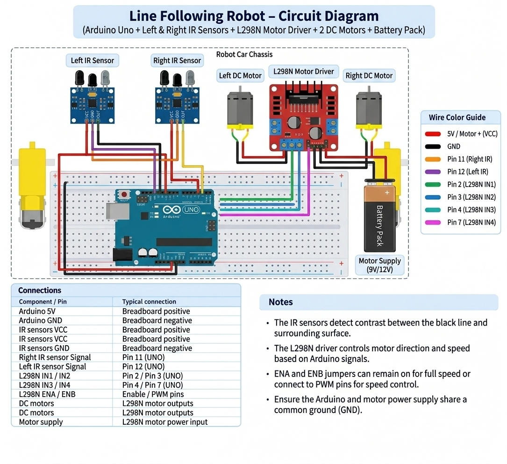

# Line Following Robot

## Aim
To build a robot that follows a marked path using infrared sensors.

## What is the project?
A mobile robot that detects the contrast between a line and its surrounding surface and adjusts its motors to stay on the path.

## How does it work?
- The IR sensors emit infrared light and detect light reflected from the surface.
- The sensors distinguish between the line and surrounding surface based on their reflected signals.
- The Arduino Uno reads the sensor outputs and determines whether the robot is centred or needs to correct its direction.
- The Arduino sends commands to the L298N motor driver.
- The driver controls the motors so the robot moves forward, turns, or corrects its position to follow the line.

## Components used
- Arduino Uno
- 2 infrared (IR) sensors
- L298N motor driver
- 2 DC motors
- Robot car chassis
- Breadboard
- Jumper wires
- Suitable motor power supply

## Connections

| Component / Pin | Typical connection |
|---|---|
| Arduino 5V | Breadboard positive |
| Arduino GND | Breadboard negative |
| IR sensors VCC | Breadboard positive |
| IR sensors GND | Breadboard negative |
| Right IR sensor Signal | Pin 11 (UNO) |
| Left IR sensor Signal | Pin 12 (UNO) |
| L298N IN1 | Pin 2 (UNO) |
| L298N IN2 | Pin 3 (UNO) |
| L298N IN3 | Pin 4 (UNO) |
| L298N IN4 | Pin 7 (UNO) |
| L298N ENA / ENB | Enable pins; PWM pins if speed control is used |
| DC motors | L298N motor output channels |
| Motor supply | L298N motor power input within specifications |

## Circuit Diagram

## Notes
- The IR sensors detect contrast between the line and the surrounding surface.
- The L298N driver controls motor direction and speed based on Arduino signals.
- ENA and ENB jumpers can remain on for full speed or connect to PWM pins for speed control.
- Ensure the Arduino and motor power supply share a common ground (GND).
- Sensor output behaviour can vary with the surface and module adjustment; test the sensors before running the robot.
